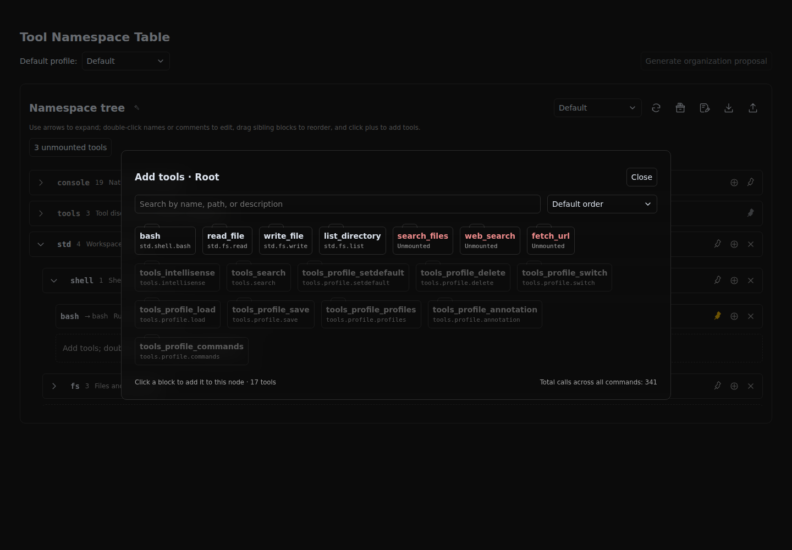
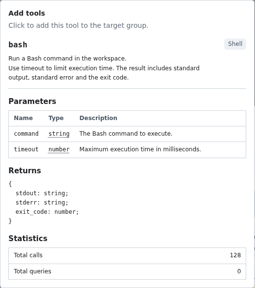

# dsh-intellisense

English | [简体中文](README.zh-cn.md)


dsh-intellisense helps you organize and discover tools in DeepSeek Harness. Group tools, give them clear names and descriptions, and save reusable profiles for different tasks. The agent can look up the tools it needs on demand.

## Installation

Requires Node.js >=24 and DeepSeek Harness >=0.2.1-rc.2.

### Install from npm

Start DeepSeek Harness once to initialize the profile you want to use, then stop it. In that profile's directory (the directory containing its `package.json`), run:

```sh
npm install @aldveylor/dsh-intellisense
```

In the same `package.json`, append `"@aldveylor/dsh-intellisense"` to the existing `dsh.profile.bundles` list, keeping the other entries. Restart DeepSeek Harness with that profile.

Alternatively, open **Plugins** in the DeepSeek Harness sidebar and install `@aldveylor/dsh-intellisense` from the npm registry, with the bundle enabled. This handles installation and activation for the current profile.

### Run from source

From the project root, with pnpm installed, run:

```sh
pnpm install --frozen-lockfile
./run.sh
```

This starts a separate development profile for trying the plugin locally.

## Getting started

1. Open the **@aldveylor/dsh-intellisense** plugin's configuration page.
2. Add the tools you want, then organize their groups, names, and descriptions.
3. Save a profile to reuse your setup.
4. Select **Intellisense PTC** or **Intellisense** as the agent mode for a session.

Both modes share your tool profiles. **Intellisense PTC** lets the agent combine tool calls in code; **Intellisense** lets it call tools individually. Choose the mode that fits your workflow.

## Tool management

### Namespace management

The namespace tree shows tool groups, call names, and descriptions. Hover a namespace for its name, full path, and notes; hover a command for its summary, full documentation, and call totals. Its original command name opens a second tooltip with tool details. Expand groups, double-click names or comments to edit them, drag sibling entries to reorder them, and set pinned hint levels. Use the controls above the tree to switch, save, or save a copy of a profile for reuse across different tool configurations.


### Adding tools

Click the tool icon beside “Namespace tree” to open the tool picker. The unmounted count opens a filtered list. Search by name, path, or description, then click an ordinary tool card to add it to the current node. Built-in plugin commands appear as disabled gray cards.



### Tool details

Hover a card for its original name, description, parameters, return type, and call totals. Parameter types have nested tooltips showing the type expression directly. Table titles sit outside their tables, and columns size to content. Hold Alt to keep a tooltip in place, then move into it to scroll manually.



## License

[Apache License 2.0](LICENSE).
