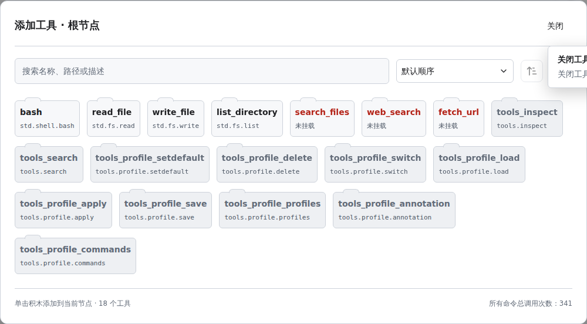
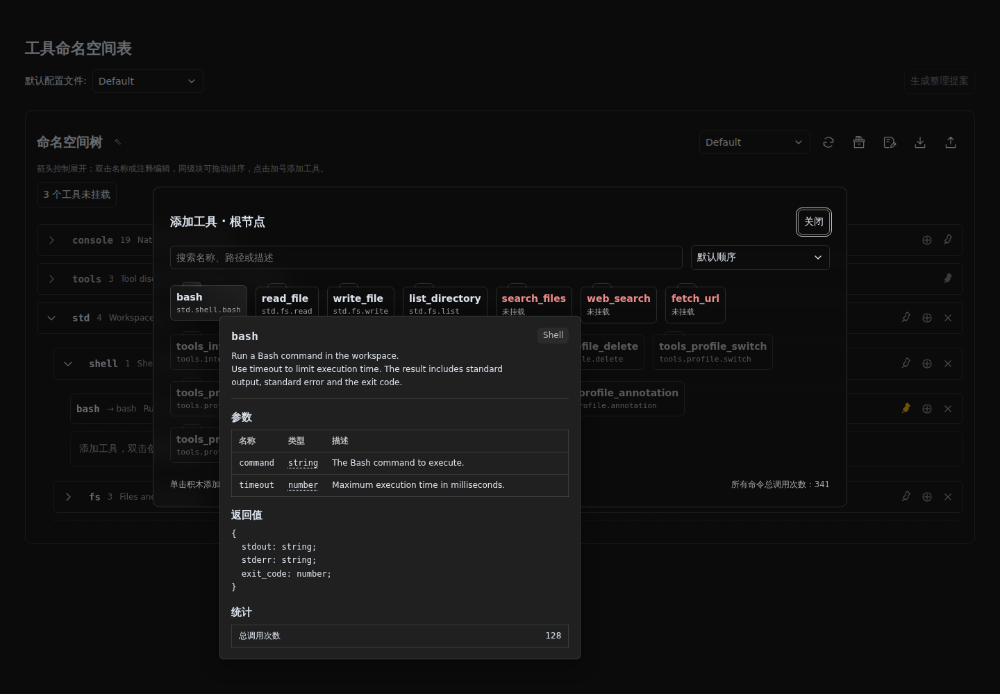

# dsh-intellisense

[English](README.md) | 简体中文


dsh-intellisense 帮助你在 DeepSeek Harness 中整理和查找工具。你可以为工具分组、设置清晰的名称与说明，并将配置保存为可复用的 Profile，适应不同任务。Agent 会按需查询所需工具。

## 使用方法

查看[使用文档](docs/zh-cn/usage.md)，了解工具分组、Agent 可见范围和界面操作；也可从插件配置页打开。

## 安装

**官方 DSH 桌面端：** 打开应用中的 **设置 → 插件**，搜索 `@aldveylor/dsh-intellisense`，通过应用的插件管理器安装，无需使用命令行。

**常规 dsh web：** 执行以下命令，然后重启 dsh web：

```sh
dsh plugin --profile web add @aldveylor/dsh-intellisense
```

**自定义运行配置：** 将命令中的 `web` 替换为宿主实际使用的运行配置名称：

```sh
dsh plugin --profile <profile> add @aldveylor/dsh-intellisense
```

按照宿主的说明重启。

## 开发（Development）

需要 Node.js >=24、DeepSeek Harness >=0.2.1-rc.2。

### 通过 npm 安装

先启动一次 DeepSeek Harness，初始化准备使用的运行配置（profile），然后停止运行。在该运行配置的目录（包含其 `package.json` 的目录）中执行：

```sh
npm install @aldveylor/dsh-intellisense
```

在同一个 `package.json` 中，将 `"@aldveylor/dsh-intellisense"` 追加到已有的 `dsh.profile.bundles` 列表，保留其他条目。随后使用该运行配置重新启动 DeepSeek Harness。

也可以打开 DeepSeek Harness 侧边栏的 **插件** 页面，从 npm 注册表安装 `@aldveylor/dsh-intellisense` 并启用该插件包。此方式会为当前运行配置完成安装和启用。

### 从源码启动

安装 pnpm 后，在项目根目录执行：

```sh
pnpm install --frozen-lockfile
./run.sh
```

此方式使用独立的开发运行配置，方便在本地体验插件。

## 工具管理

查看[使用文档](docs/zh-cn/usage.md)，也可从配置页内打开。下方截图统一使用浅色模式。

### 命名空间管理

命名空间树展示工具分组、调用名称与工具说明。悬停命名空间可查看名称、完整路径和注释；悬停命令可查看简化注释、完整文档及调用统计，其原始命令名可打开第二层工具详情。可展开分组、双击名称或注释进行编辑，拖动同级条目调整顺序，并设置固定提示级别；顶部可切换、保存或另存为 Profile，方便复用不同的工具配置。


### 添加工具

点击“命名空间树”标题后的工具图标打开添加工具界面；未挂载工具数量入口可筛选尚未挂载的工具。可按名称、路径或描述搜索，点击普通工具卡片加入当前节点，再在树中调整名称和分组。本插件内置命令以灰色禁用卡片显示，不能重复挂载。



### 工具详情

悬停工具卡片可查看原始名称、描述、参数、返回类型和调用统计。参数类型拥有二层 Tooltip，类型直接显示表达式；参数与统计标题置于表格外，列宽按内容自适应。按住 Alt 固定提示，移入可手动滚动。



## 许可

[Apache License 2.0](LICENSE)。
