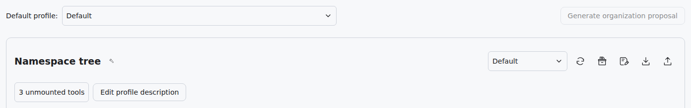
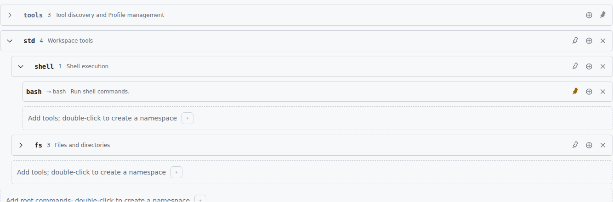
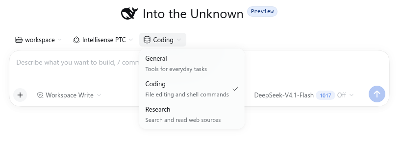

# Usage guide

Open the @aldveylor/dsh-intellisense plugin configuration page in DSH to organize tools and save configurations. The Usage guide button at the top right opens this guide. Screenshots use light mode; the interface follows your DSH theme.

## Namespaces: group tools by purpose

A namespace is a group of tools, and can contain smaller groups like folders. It helps both you and the agent find tools by purpose. For example, put reading and writing tools in a files group, and search tools in a research group. Add subgroups when a group becomes crowded.

Groups expand and collapse; tools inside them represent individual operations. Names identify entries, and comments explain their purpose. Choose short, distinct names and a sentence describing each purpose. Keep tools used together in the same group and avoid unnecessary nesting.

## Profiles: save a complete tool arrangement

A Profile saves your groups, names, comments, pin settings and enabled states. Prepare separate configurations for tasks such as coding or research. A Profile description explains its purpose and helps you choose it from menus.

The same tool can appear in multiple Profiles, or in several places within one Profile. Each placement has independent names, comments, pins and enabled states. Editing or removing one placement leaves the others intact and does not uninstall the tool.

## What the agent can see

Select Intellisense or Intellisense PTC for a conversation to use its chosen tool configuration. Other modes use DSH's own tool presentation. Intellisense suits individual tool calls; Intellisense PTC suits combining several tool operations. Both share your Profiles.

The management tool catalog is for choosing tools; it does not mean the current agent sees every listed tool. An ordinary tool outside the selected configuration is not automatically offered just because it appears in the catalog. The tool also needs to be available in the current conversation.

Pin levels control how tools are introduced. Level 0 (unpinned) lets the agent look up a tool when needed; level 1 (brief) highlights its name and short purpose; level 2 (detailed) provides full calling information. Use detailed pins for frequent tools and discovery for occasional ones. Intellisense offers pinned tools as callable entries and adds other entries when the agent looks up a specific tool. Intellisense PTC presents tool hints according to their pin levels.

A namespace pin introduces the group without setting every tool inside to detailed. Expanding or collapsing a group only changes your view. Disabling a tool keeps its configuration but removes it from discovery and execution. Disabling a group affects all tools beneath it.

Keep the built-in discovery entry enabled so the agent can find tools without detailed pins. If you disable discovery, the page advises when other tools need level 2 pins or should be disabled. You can still edit and save.

## Find your way around the page

There are two places to use: organize and save Profiles in management, then choose one for a conversation on its home screen. The default selector at the top of management sets the choice for new conversations; the menu beside the namespace tree chooses what you are editing. These can be different.

The following sections follow the workflow, with focused screenshots beside the relevant controls. Button hints show an action first and its effect in subdued text below.

## Create, select and save a Profile

Open the selector beside the namespace tree and choose a Profile to edit. For an empty configuration, enter a name at the bottom of the menu and press Enter. To start from the current arrangement, click Save as and enter a new name. Double-click an existing name in the menu to rename it, or use its delete button to remove an unwanted Profile. The last saved Profile cannot be deleted.

A star beside the name marks unsaved edits. Save writes your arrangement to that Profile; Save as stores it under a different name. To describe its purpose, click Edit Profile description, enter a summary, click Apply, then save the Profile.

Refresh reloads the saved configuration and updates the tool catalog, replacing unsaved edits. Save or download first to keep your changes. Changing the default Profile at the top does not switch the configuration you are editing.

## Add tools and create groups

Click the tool icon beside Namespace tree to add tools at the outermost level. To add inside a group, expand it and click its plus button. Search the picker by name, path or description, or sort by name, call count or query count. Click an available card to add it.

Use the sort menu to choose name, call count or query count, then its direction button to switch ascending or descending. Direction is unavailable for the default order. The filter button lets you combine unmounted, mounted and built-in fixed tools. Filtering and sorting only change the picker display.

The unmounted-tools entry shows only tools not yet added to the current Profile. Card footers show existing placements; adding a tool again creates another placement. Gray built-in cards cannot be added again.

At the outermost level or inside a group, double-click the placeholder text offering to create a namespace. Enter a group name, then press Enter or move focus away to confirm; Escape cancels. Use the plus button to add tools, or drag existing tools into the group.

## Rename, describe and move entries

Click a group's arrow to expand or collapse it. Double-click an ordinary group or tool name to rename it, or its comment to edit its purpose. In the tool comment dialog, Apply updates the draft, Reset restores the original tool description, and Cancel discards the current input. Save the Profile afterward.

Drag tools or groups to reorder siblings or move them between groups. Drop in the middle of a group to move inside; drop in a gap before or after an entry to reorder. Built-in names and positions are protected, with unavailable actions locked.

## Pin, disable and remove

Click an ordinary tool's pin to cycle through unpinned, brief, detailed and back to unpinned. Detailed pins are solid yellow. A namespace pin only toggles whether to introduce that group. The built-in discovery tool's pin level is locked.

An enabled entry shows a circled plus; click to disable it. A disabled entry shows a circled slash; click to enable it again. Disabled rows turn gray and retain their settings. When a parent group is disabled, enable it before changing its children's enabled states.

The removal button deletes the current tool placement, or the group and its contents. Disable entries for temporary pauses and remove arrangements you no longer need. Save afterward to reuse either change.

## View tool details

Hover a group to see its name, full location and description. Hover a tool for its short comment, full documentation and statistics; hover its original tool name within that tooltip for more details. Cards in the picker also show details on hover.

Details show required inputs, their types, what the tool returns, and call and query counts. Hover a parameter type to inspect its structure. Hold Ctrl to keep the tooltip in place, then move inside to scroll. Counts help identify frequent tools; placements of the same tool share tool statistics.

## Download and upload configurations

Download saves the current draft as a JSON file, including unsaved changes, for backup or sharing. Upload validates a selected configuration file and replaces the current draft while keeping its name and the default Profile selection. Click Save to persist the result. Invalid files display an error and leave the draft intact.

## Use a Profile in a conversation

Save your arrangement, open a blank conversation and select Intellisense or Intellisense PTC. Choose a Profile from the menu beside the mode on the conversation home screen, then start chatting. A grayed-out Profile button means the mode specifies a fixed configuration that cannot be changed there.

The Profile button sits to the right of Intellisense PTC. Click its name to open the menu and choose a configuration for this task before sending your first message.

New conversations without a specified configuration use the default Profile. Existing conversations retain their own working configurations, so saving a Profile with the same name or changing the default does not update them automatically. To apply saved edits, select another Profile on the conversation home screen, then switch back to the updated one. The home-screen menu disappears once chatting begins; you can then ask the agent to switch to a Profile by name.

## Ask the agent to organize tools

Generate organization proposal opens a new conversation draft with suggested instructions. Review or edit the instructions and send them manually. The agent can organize groups, shorten comments and save several task-specific Profiles. Return to management, refresh and review the results, then choose your default Profile. This button is unavailable on standalone management pages that cannot open a DSH conversation.
