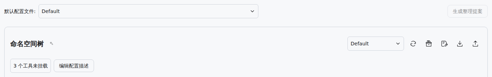
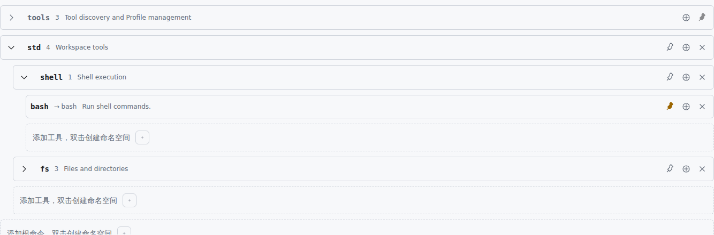

# 使用方法

先跟着下面的例子准备一套“编程”配置，再用它开始对话。在 DSH 中打开 `@aldveylor/dsh-intellisense` 插件的配置页；右上角的“使用文档”可随时打开本文。截图使用浅色模式，实际界面跟随 DSH 主题。

## 先认识命名空间和配置文件

命名空间像工具文件夹。例如创建 `project`，把读取文件和搜索内容的工具放进去，分别命名为 `read` 和 `search`，Agent 就能按 `project.read`、`project.search` 查找它们。这里的名字是你设置的别名；添加时要选择当前 DSH 中实际可用的工具。

配置文件（Profile）保存整套工具分组、别名、注释、固定方式和启用状态。例如“编程”放项目工具，“研究”放网页搜索工具。同一个工具可以加入多套配置，或在一套配置里放在多个位置，各位置可独立调整。

## 示例一：准备“编程”配置

打开命名空间树旁的配置菜单，在底部输入“编程”并按 Enter，创建空白配置。如果已有接近的配置，先选中它，再点击“另存为”输入“编程”，保留原配置供其它任务使用。顶部“默认配置文件”决定新对话的默认选择；树旁菜单决定当前编辑哪一套配置。

点击“编辑配置描述”，填写“阅读项目文件、搜索代码并辅助修改”，点击“应用”。名称旁的星号表示未保存，完成下面的工具安排后点击“保存”。菜单内双击配置名称可重命名，删除按钮可删除配置；最后一套已保存配置不能删除。

## 给示例配置添加工具

在树中双击“双击创建命名空间”，输入 `project`，按 Enter 确认；Escape 取消。展开 `project`，点击组内加号，在工具选择器里搜索并添加你实际安装的文件读取工具，再添加内容搜索工具。最外层的工具图标可将工具直接加入根目录。

例如要找读取工具，可以搜索“读取”或它的原始工具名，悬停卡片确认用途和参数后再添加。“未挂载工具”入口只列出尚未加入当前配置的工具；卡片底部显示已有位置，再次添加会新增一个位置。灰色内置卡片不可重复添加。

列表可按名称、调用次数或查询次数排序，方向按钮切换升降序；默认顺序下不可切换方向。筛选按钮可组合查看未挂载、已挂载和内置固定工具。

## 把工具改成容易使用的名字

双击刚添加的读取工具名称，改为 `read`；将搜索工具改为 `search`。双击注释，分别写成“读取项目中的文本文件”和“按关键词搜索项目文件”。点击注释编辑框的“应用”更新草稿；“重置”恢复原始工具说明，“取消”放弃本次输入。

现在读取工具的位置是 `project.read`，搜索工具的位置是 `project.search`。如果添加到了根目录，拖到 `project` 中间即可移入；拖到条目前后的空位可调整顺序。分组也能拖动。内置条目的名称和位置受保护。

## Agent 能看到什么

在这个例子中，保留内置 `tools.inspect` 发现入口，将 `project.read` 的图钉点到黄色实心的“详细”，把 `project.search` 留为“不固定”，然后保存。Agent 开始时能获得读取工具的完整调用信息，需要搜索时再查找搜索工具。

普通工具的图钉按“不固定（0）→ 简略（1）→ 详细（2）→ 不固定”循环。简略用于提示名称和用途；详细提供完整调用信息。分组图钉只提示分组存在，不会把全部子工具一起详细固定；展开和收起只改变页面显示。内置发现工具的固定等级不可切换。

选择 Intellisense 模式时，Agent 逐个调用工具，查到具体工具后增加对应调用入口；选择 Intellisense PTC 时，Agent 可以用代码组合多个工具操作。两者共用配置，实际调用仍以当前对话可用的工具和权限为准。工具仅出现在管理页目录中，还不足以让 Agent 使用；请先添加到当前配置。

## 在对话中使用配置

保存“编程”配置，打开空白对话，选择 Intellisense 或 Intellisense PTC，再从模式右侧的配置菜单选择“编程”。配置按钮置灰表示该模式指定了固定配置。

你可以发送：“先阅读项目说明，再搜索登录入口，告诉我认证逻辑在哪些文件中。先不要修改文件。”

示例过程：Agent 使用 `project.read` 阅读说明 → 按需发现 `project.search` 的参数 → 搜索登录入口 → 汇总相关文件与依据。实际回复与调用顺序取决于模型和工具返回结果，你只需描述目标，无需手动输入工具调用代码。

开始对话后，首页配置菜单会隐藏。已有对话保留各自的工作配置；管理页保存同名配置或更改默认项，不会自动更新它们。若仍在首页，可选另一套配置再切回；开始对话后可发送：“请切换到已保存的‘编程’配置，然后继续查找认证逻辑。”

## 示例二：切换到“研究”任务

在管理页新建“研究”配置，创建 `research` 命名空间，加入当前可用的网页搜索和网页读取工具，分别命名为 `search`、`read`，保留发现入口并保存。没有相应工具时，先在 DSH 中安装或启用它们，再回来添加。

新对话选择“研究”后，可以发送：“比较这两个项目的安装方式和维护情况，先查看各自的官方文档，再附上信息来源。” Agent 可按需查找 `research` 下的工具并收集资料。要在已有对话使用它，可以发送：“切换到‘研究’配置，再开始比较。”

## 调整示例：临时停用和清理工具

例如暂时不需要搜索，点击 `project.search` 右侧的圆圈加号即可禁用；行变灰后保留配置，但不再参与发现和执行。点击圆圈斜线可重新启用。禁用整个 `project` 会停用其下所有工具，调整子工具前要先启用父分组。

如果只是放错位置，用拖动移动它；如果不再需要这个位置，点击删除。删除分组会同时删除其下内容，但不会卸载原始工具。编辑后保存；“刷新”会用已保存内容替换未保存草稿，需要保留修改时请先保存或下载。

## 示例三：查看参数并备份配置

如果不确定 `project.search` 能搜索哪些内容，悬停该工具查看说明和参数，再悬停其中的原始工具名打开详细信息。悬停参数类型可查看结构；按住 Ctrl 固定提示框，再移入滚动查看。工具选择器卡片也支持悬停查看详情，同一工具的多个位置共享调用与查询统计。

整理完成后点击“下载”，把当前草稿（包括未保存修改）备份为 JSON。要复用这份安排，先选择或创建目标配置，再点击“上传”选择文件，检查结果后“保存”。上传保留当前配置名称和默认选择；无效文件会提示原因并保留原草稿。

## 示例四：请 Agent 帮忙整理

点击“生成整理提案”打开预填要求的新对话草稿，按需修改后手动发送。例如：“请按编程和研究两种用途整理工具，分别保存为‘编程’和‘研究’配置；名称简短，注释用一句话说明用途，保留工具发现入口。”

Agent 完成后回到管理页刷新，检查配置分组、工具和注释，再选择默认配置或在新对话中选用。该按钮在无法打开 DSH 对话的独立管理页面中不可用。
